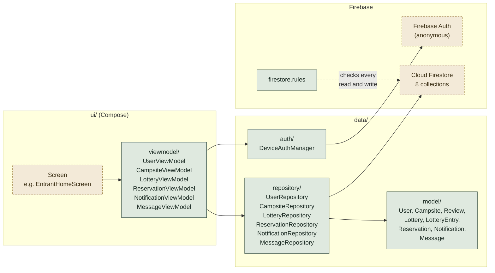

# Database Design (Firestore)

**CMPUT 301 | Team Turing | Part 3**

This document describes how the classes from the Part 2 CRC cards are stored in
Cloud Firestore, how users are identified, and how the Kotlin code is organised
around it. Field names here are the ones the code should use. Change this file
first, then the code.

## 1. Decisions

1. **Firestore, not Realtime Database.** Firestore has collections and documents,
   supports queries on several fields, and is what the course examples use.
2. **One `users` collection with a `roles` field** instead of separate entrant,
   owner and admin collections. `User` is the base class in the CRC design, and
   a user needs more than one role: in the UI and the storyboard a regular
   user is both an entrant and an owner, and switches between the entrant
   view and the owner view. A new user therefore gets `roles = [ENTRANT, OWNER]`.
   `ADMIN` is added on top for admin accounts, which US 03.11.01 says can still
   act as an owner or entrant.
3. **Device-based identity through Firebase Anonymous Auth** (US 01.09.01).
   On first launch the app signs in anonymously and gets a `uid`. That `uid` is
   the document id in `users`. No username or password anywhere.
4. **Screens never call Firestore directly.** Every read and write goes through
   a repository class (section 4). This keeps the UI code free of Firebase
   details and makes the model classes unit-testable.
5. **Lottery entries are a sub-collection**, not an array on the lottery
   document. A waitlist can be large, and a sub-collection lets the owner page
   through it and lets an entrant leave without rewriting the whole list.

## 2. Collections

Field types are Firestore types. `ref` means the string id of a document in
another collection. `Timestamp` is a Firestore timestamp.

### `users/{uid}`

| Field | Type | Notes |
|---|---|---|
| `name` | string | |
| `email` | string | optional |
| `phone` | string | optional |
| `roles` | array of string | any of `entrant`, `owner`, `admin` |
| `notificationsEnabled` | boolean | US 01.10.01, default `true` |
| `createdAt` | Timestamp | |

Stories: 01.07.03, 01.08.01, 01.09.01, 01.10.01, 03.02.01, 03.05.01, 03.07.01, 03.11.01

### `campsites/{campsiteId}`

| Field | Type | Notes |
|---|---|---|
| `ownerId` | ref to `users` | |
| `name` | string | |
| `location` | string | human-readable address |
| `geoPoint` | GeoPoint | optional, for map and distance filter |
| `description` | string | amenities text |
| `maxOccupancy` | number | |
| `tags` | array of string | |
| `imageUrl` | string | optional; where images are stored is not decided yet |
| `ratingAverage` | number | computed from `reviews` |
| `ratingCount` | number | |
| `rulesText` | string | shown before confirming a reservation (US 02.11.01) |
| `createdAt` | Timestamp | |
| `mapLocation` | string | place shown on the map, typed in the campsite form |
| `cancellationPolicy` | string | refund terms shown to entrants |
| `confirmationRequired` | boolean | default `true`; entrant must accept the rules first |
| `active` | boolean | default `true`; `false` when the owner pauses the campsite |

Stories: 01.01.01 to 01.01.05, 01.12.01, 02.01.01 to 02.01.04, 02.02.01, 02.03.01, 03.01.01, 03.04.01

The QR code for US 02.02.01 does not need its own field. It encodes the
`campsiteId`, and the app looks the campsite up when scanned.

### `campsites/{campsiteId}/reviews/{reviewId}`

| Field | Type | Notes |
|---|---|---|
| `entrantId` | ref to `users` | |
| `rating` | number | 1 to 5 |
| `comment` | string | optional |
| `createdAt` | Timestamp | |

Stories: 01.13.01

### `lotteries/{lotteryId}`

| Field | Type | Notes |
|---|---|---|
| `ownerId` | ref to `users` | |
| `campsiteIds` | array of ref | one or more campsites (US 02.04.02) |
| `registrationStart` | Timestamp | |
| `registrationEnd` | Timestamp | winners are drawn after this (US 02.05.01) |
| `bookingStart` | Timestamp | first date a winner can reserve |
| `bookingEnd` | Timestamp | last date a winner can reserve |
| `winnerCount` | number | US 02.04.05 |
| `waitlistCapacity` | number | optional, `null` means unlimited (US 02.04.07) |
| `status` | string | `open`, `drawn`, `closed` |
| `createdAt` | Timestamp | |

Stories: 02.04.01 to 02.04.07, 02.05.01, 01.02.01, 01.03.01, 01.03.02

### `lotteries/{lotteryId}/entries/{entrantId}`


| Field | Type | Notes |
|---|---|---|
| `entrantId` | ref to `users` | same as the document id |
| `joinedAt` | Timestamp | |
| `result` | string | `pending`, `won`, `lost`, `declined` |

Stories: 01.02.01, 01.02.02, 01.04.03, 02.09.01

### `reservations/{reservationId}`

| Field | Type | Notes |
|---|---|---|
| `entrantId` | ref to `users` | |
| `ownerId` | ref to `users` | copied from the campsite for easy querying |
| `campsiteId` | ref to `campsites` | |
| `lotteryId` | ref to `lotteries` | |
| `startDate` | Timestamp | |
| `endDate` | Timestamp | |
| `status` | string | `active`, `completed`, `cancelled`, `rejected` |
| `rulesAccepted` | boolean | US 02.11.01 |
| `createdAt` | Timestamp | |

Stories: 01.04.01 to 01.04.03, 01.05.01, 01.06.01, 01.06.02, 01.07.01, 02.06.01, 02.07.01 to 02.07.03, 02.08.01

"Booked dates" for US 02.06.01 is a query: reservations where `campsiteId`
matches and `status` is `active`. No separate availability document is needed.

### `notifications/{notificationId}`

| Field | Type | Notes |
|---|---|---|
| `toUserId` | ref to `users` | |
| `fromUserId` | ref to `users` | `null` for system notifications |
| `type` | string | `lotteryWon`, `lotteryLost`, `reservationConfirmed`, `reservationCancelled`, `ownerMessage` |
| `title` | string | |
| `body` | string | |
| `read` | boolean | |
| `createdAt` | Timestamp | |

Stories: 01.03.01, 01.03.02, 01.05.01, 01.07.02, 02.10.01, 02.10.02, 03.08.01

### `messages/{messageId}`

| Field | Type | Notes |
|---|---|---|
| `reservationId` | ref to `reservations` | |
| `fromUserId` | ref to `users` | |
| `toUserId` | ref to `users` | |
| `body` | string | |
| `createdAt` | Timestamp | |

Stories: 02.12.01, 03.12.01

### Images

Where campsite and profile pictures are stored has not been decided yet.
Firestore will only hold a URL or path in `imageUrl`; the storage service
(Firebase Storage or something else) is an open question for the team.

## 3. Relationships

Editable version of this diagram in FigJam: https://www.figma.com/board/C6EjwqZoi81zpu3dZu6Qki

`1 ──── *` reads as one-to-many.

```
users 1 ──── * campsites         (ownerId)
users 1 ──── * reservations      (entrantId, ownerId)
users 1 ──── * notifications     (toUserId)
campsites 1 ─ * reviews          (sub-collection)
campsites * ─ * lotteries        (campsiteIds array)
lotteries 1 ─ * entries          (sub-collection, id = entrant uid)
lotteries 1 ─ * reservations     (lotteryId)
reservations 1 ─ * messages      (reservationId)
```

## 4. Kotlin layout

How a screen reaches the database. Green boxes exist in the code today;
dashed boxes are still to be written or configured.



```
app/src/main/java/com/turing/campsite/
├── data/
│   ├── model/            one data class per collection, no logic
│   │   ├── User.kt
│   │   ├── Campsite.kt
│   │   ├── Review.kt
│   │   ├── Lottery.kt
│   │   ├── LotteryEntry.kt
│   │   ├── Reservation.kt
│   │   ├── Notification.kt
│   │   └── Message.kt
│   ├── repository/       one class per collection, all Firestore calls live here
│   │   ├── UserRepository.kt
│   │   ├── CampsiteRepository.kt
│   │   ├── LotteryRepository.kt
│   │   ├── ReservationRepository.kt
│   │   ├── NotificationRepository.kt
│   │   └── MessageRepository.kt
│   └── auth/
│       ├── DeviceAuthManager.kt     anonymous sign-in, exposes current uid
│       └── TempUser.kt              fixed test uid, delete once sign-in is connected
└── ui/
    ├── viewmodel/        one view model per repository, screens talk to these
    │   ├── BaseViewModel.kt         shared isLoading and errorMessage
    │   ├── UserViewModel.kt
    │   ├── CampsiteViewModel.kt
    │   ├── LotteryViewModel.kt
    │   ├── ReservationViewModel.kt
    │   ├── NotificationViewModel.kt
    │   └── MessageViewModel.kt
    ├── mapper/           turn models into what screens draw, and forms into models
    │   ├── CampsiteMapper.kt
    │   └── UserMapper.kt
    └── ...                          screens, components, theme
```

Rules for this layer:

- Model classes are Kotlin `data class`es with default values for every field,
  so Firestore can construct them. Enum-like fields (`status`, `roles`, `type`) are `enum class`es in Kotlin and are
  stored in Firestore as the enum name in upper case, for example `ENTRANT` or
  `ACTIVE`. The lower-case values in the tables above are shorthand.
- Repository functions are `suspend` and return the model, a list, or throw.
  Screens call them from a `ViewModel`, never from a composable directly.
- There is one view model per repository, shared by every screen that shows
  that data. A screen gets it with `viewModel()`, calls a load function, and
  reads the list. If a call fails the message is in `errorMessage`.
- Until sign-in on launch is connected, screens use `TempUser.UID` as the
  current user id.
- Each repository gets its collection from `FirebaseFirestore.getInstance()`.
  Model classes contain no Firebase calls, so they are the part covered by
  unit tests.
- Every class and public function has a KDoc comment in the style from Lab 6:
  a one-line summary, a short paragraph, then `@property` tags on classes and
  `@param` / `@return` tags on functions. `./gradlew dokkaGenerateHtml` builds
  the HTML docs from these comments.
- Unit tests live in `app/src/test` and follow the Lab 6 layout: a `@Before
  setUp()` that builds a fresh object, and one test per behaviour named
  `function_case_result`, for example `isRegistrationOpen_afterEnd_false`.

## 5. Security rules (first version)

```
rules_version = '2';
service cloud.firestore {
  match /databases/{database}/documents {
    function signedIn() { return request.auth != null; }
    function isSelf(uid) { return signedIn() && request.auth.uid == uid; }
    function isAdmin() {
      return signedIn()
        && 'admin' in get(/databases/$(database)/documents/users/$(request.auth.uid)).data.roles;
    }

    match /users/{uid} {
      allow read: if signedIn();
      allow create, update: if isSelf(uid);
      allow delete: if isSelf(uid) || isAdmin();
    }

    match /campsites/{id} {
      allow read: if signedIn();
      allow create: if signedIn();
      allow update, delete: if signedIn()
        && (resource.data.ownerId == request.auth.uid || isAdmin());
      match /reviews/{reviewId} {
        allow read: if signedIn();
        allow create: if signedIn();
      }
    }

    match /lotteries/{id} {
      allow read: if signedIn();
      allow create: if signedIn();
      allow update, delete: if signedIn()
        && (resource.data.ownerId == request.auth.uid || isAdmin());
      match /entries/{entrantId} {
        allow read: if signedIn();
        allow create, delete: if isSelf(entrantId);
      }
    }

    match /reservations/{id} {
      allow read, create: if signedIn();
      allow update: if signedIn()
        && (resource.data.entrantId == request.auth.uid
            || resource.data.ownerId == request.auth.uid
            || isAdmin());
    }

    match /notifications/{id} {
      allow read: if signedIn() && resource.data.toUserId == request.auth.uid || isAdmin();
      allow create: if signedIn();
      allow update: if signedIn() && resource.data.toUserId == request.auth.uid;
    }

    match /messages/{id} {
      allow read: if signedIn()
        && (resource.data.fromUserId == request.auth.uid
            || resource.data.toUserId == request.auth.uid
            || isAdmin());
      allow create: if signedIn();
    }
  }
}
```

These rules are deliberately loose on `create` so the app can be built without
fighting permissions. Tighten them before the final demo.

## 6. Gradle additions

Under the existing Firebase BoM in `app/build.gradle.kts`:

```kotlin
implementation("com.google.firebase:firebase-firestore")
implementation("com.google.firebase:firebase-auth")
```

## 7. Not covered yet

- Push notifications (Firebase Cloud Messaging). In-app notifications work
  without it; add it once the `notifications` collection is stable.
- Automatic lottery draw at `registrationEnd`. First version draws when the
  owner presses a button; a Cloud Function can do it on a schedule later.
- Deleting a user (US 01.08.01) must also clean up their reservations and
  entries. Do this in `UserRepository.delete` as a batch write.
- Image storage. See the Images note in section 2.
